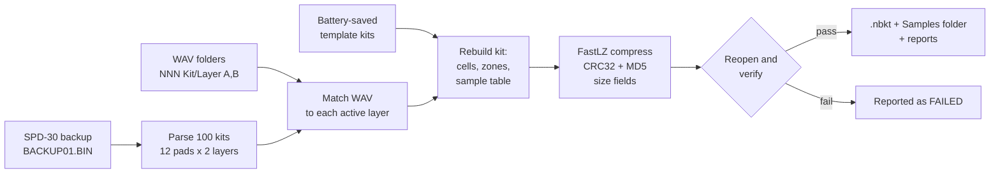

# SPD-30 to Battery 4 — Drum Kit Converter

Turn the kits stored in a **Roland SPD-30 (Octapad)** backup into **Native Instruments Battery 4** kits, with each pad's samples, MIDI note, volume and tuning carried over.

Plain Python, no third-party packages. It reads one backup file and a folder of WAV samples, and writes one Battery 4 kit (`.nbkt`) plus a samples folder per SPD-30 kit. Every file it writes is reopened and checked before it reports success.

> **Status: experimental.** The converter's output passes all of its own binary checks. Kits made by the parameter-only generator (`nbkt_gen.py`) have been opened in Battery 4. Kits with linked samples, which `build_john_deni_battery4_kits.py` makes, have not yet been confirmed to load and play in Battery 4. See [Limitations](#limitations).

---

## Why this exists

A drummer who has spent years building kits on an SPD-30 has their whole setup locked inside the device: which sound is on which pad, which MIDI note each pad sends, and how loud and how tuned each layer is. Moving to a software drum sampler such as Battery 4 normally means rebuilding every kit by hand, cell by cell.

Neither format is documented. The SPD-30 backup is a binary dump, and a Battery 4 kit is a compressed, checksummed binary container. This project decodes the first, rebuilds the second, and checks its own work at every step.

## Features

- Reads all 100 kits of an SPD-30 backup: 8 pads + 4 external triggers, each with Layer A and Layer B.
- Includes only layers that actually sound on the SPD-30 (see [Which layers are converted](#which-layers-are-converted)).
- Finds each layer's WAV file, copies it next to the kit and links it by relative path.
- Carries over the MIDI note as Battery's key range, and the layer's volume and tuning.
- Gives layers with no MIDI note a free key of their own (120–127, then 119 downwards), so every cell can still be played.
- Verifies every kit it writes: size fields, FastLZ stream, CRC32, MD5, zone and sample-table contents, every cell's parameters, and every unused cell.
- Checks its format model against your own Battery-saved kits before it writes anything.
- Writes a Markdown report and a per-cell CSV.
- Bonus: `spd30_to_spd20x_midi.py` copies the same MIDI notes into a Roland SPD-20X backup.

## How it works



1. **Parse the backup.** The SPD-30 stores 100 kit records of 654 bytes. Each has 12 pad records of 36 bytes, and each pad holds two 16-byte layer records.
2. **Decide which layers sound** (volume above 0, instrument not OFF, not muted, and Layer B only when the pad uses it).
3. **Find the samples.** For each sounding layer, look in `NNN Kit/Layer A/` or `Layer B/` for a WAV starting with the pad's prefix.
4. **Rebuild the Battery kit.** Start from two Battery-saved templates, fill one cell per layer, add a sample zone and a sample-table entry, then compress and checksum.
5. **Verify.** Reopen the file from disk and check everything again (see [Validation](#validation)).

The technical details are in [docs/ARCHITECTURE.md](docs/ARCHITECTURE.md).

## Pad and layer mapping

Battery 4 shows 128 cells in rows of 16. Layer A goes to row 1 and Layer B to row 2, in pad order:

| SPD-30 pad | Layer A → Battery cell | Layer B → Battery cell |
|---|---|---|
| PAD 1 … PAD 8 | cells 0–7 (row 1, columns 1–8) | cells 16–23 (row 2, columns 1–8) |
| EXT 1 … EXT 4 | cells 8–11 (row 1, columns 9–12) | cells 24–27 (row 2, columns 9–12) |

All other cells are left exactly as they are in the empty template.

### Which layers are converted

| Layer is skipped when… | Why |
|---|---|
| it's Layer B and the pad is in single mode | the SPD-30 never plays Layer B then |
| the instrument is OFF | no sound |
| the volume is 0 | no sound |
| the layer is muted | no sound |

## MIDI notes, volume and tuning

| What | In the SPD-30 backup | In the Battery kit |
|---|---|---|
| MIDI note | 0–127, or 128 = OFF | key range low = high = the note |
| Volume | level 0–100 | linear gain `level / 100` (100 → 1.0) |
| Tuning | cents + 2400 (0–4800 = −24…+24 semitones) | pitch ratio `2 ** (semitones / 12)` |

- **No MIDI note.** A sounding layer whose note is OFF still needs a key in Battery. These layers get 120, 121 … 127 in cell order (row 1 first, then row 2). If a kit has more than eight, the rest continue at 119, 118, …, and any key already used by a real note in that kit is skipped. Each layer gets its own key. The CSV report marks every one.
- **Shared notes.** If two layers of a kit have the same note, both cells use that key and play together, as on the SPD-30.
- **Volume mapping.** The SPD-30's own level-to-loudness curve is not stored in the backup, so `level / 100` keeps the relative levels but is not guaranteed to match the SPD-30's loudness exactly.
- **Where volume and tune are written.** By default they go to the cell (Battery's engine gain, plus the quick-access level and tune), and the sample zone stays at 1.0. Kits saved by Battery itself keep per-sample changes in the zone instead. If cell values do not show up as expected in Battery, rebuild with `--params zone`.

## Input you need

None of these are in the repository. You supply them.

```
input/
  BACKUP01.BIN                 SPD-30 backup (from the SPD-30's USB/backup export)
  samples/
    001 Kit Name/
      Layer A/
        1-KIK 001.wav          pad 1, Layer A   (prefix "1-" ... "8-")
        EXT1-SNR 004.wav       external trigger 1 (prefix "EXT1-" ... "EXT4-")
      Layer B/
        2-TOM 004.wav
    002 Another Kit/ ...
templates/
  Dummy.nbkt                   an EMPTY kit saved by Battery 4
  wrapper.nbkt                 a kit saved by Battery 4 with at least one sample
```

- Kit folders start with the three-digit kit number and a space. The rest of the name is free and becomes the Battery kit name.
- WAV files start with the pad prefix and a dash. The rest of the name is free.
- The WAVs must be PCM (16- or 24-bit). The SPD-30 plays sounds from internal memory and its backup holds no audio, so you need your own recordings or exports of each sound.
- How to make the templates is in [templates/README.md](templates/README.md). Extra Battery-saved kits in `templates/` make the format self-test stronger.

## Installation

You need Python 3 (tested with Python 3.14) and nothing else.

```bash
git clone https://github.com/<your-username>/spd30-to-battery4.git
cd spd30-to-battery4
python3 --version
```

`requirements.txt` is intentionally empty: only the standard library is used.

## Usage

### Prepare your files

Put your backup, samples and the two templates where [Input you need](#input-you-need) shows.

### Run

```bash
python3 build_john_deni_battery4_kits.py
```

Or give every path yourself:

```bash
python3 build_john_deni_battery4_kits.py --backup path/to/BACKUP01.BIN --samples path/to/samples --out-dir path/to/output --cell-template path/to/Dummy.nbkt --wrapper-template path/to/wrapper.nbkt
```

| Option | Default | Meaning |
|---|---|---|
| `--backup` | `input/BACKUP01.BIN` | SPD-30 backup file |
| `--samples` | `input/samples` | folder with one `NNN Kit` folder per kit |
| `--out-dir` | `output/battery4_kits` | where kits and reports are written |
| `--cell-template` | `templates/Dummy.nbkt` | empty Battery-saved kit |
| `--wrapper-template` | `templates/wrapper.nbkt` | Battery-saved kit with a sample |
| `--params` | `group` | write volume/tune to the cell (`group`) or the sample zone (`zone`) |

The script prints a summary and exits with status 0 when every kit verified, 2 when any kit failed, and 1 on a missing input.

```
format self-test: reference kits OK; zones reproduced 33/33; cell template matches: True
kits written: 94, verified: 94, failed: 0
cells: 1082, with linked sample: 1082, read-back PASS: 1082
problems: 0
```

### Output

```
output/battery4_kits/
  001 Kit Name/
    001 Kit Name.nbkt
    001 Kit Name Samples/
      A 1-KIK 001.wav          copied WAVs, prefixed A/B (pads can use the
      B 2-TOM 004.wav          same file name in both layers)
  build_report.md              summary, problems, per-kit results
  kit_cell_report.csv          one row per cell: pad, layer, key, volume, tune, sample, PASS/FAIL
```

Open a kit in Battery 4 from inside its folder, so Battery finds the `Samples` folder next to it. Keep the `.nbkt` and its `Samples` folder together if you move them.

Examples made from a synthetic demo backup are in [`examples/`](examples/): a [build report](examples/example_build_report.md), a [cell report](examples/example_kit_cell_report.csv) and the [output tree](examples/example_output_tree.txt).

### Bonus: SPD-20X MIDI export

```bash
python3 spd30_to_spd20x_midi.py --src path/to/ROLAND/SPD-20X/BACKUP
```

This copies the SPD-30's MIDI notes, channels and program changes into a copy of an SPD-20X backup, written to `output/spd20x/`. Your source folder is only read. It uses the same no-note keys as the Battery kits, and sets Layer B's channel to OFF where both layers send the same note. The mapping is documented at the top of the script.

## Validation

**Every run** checks, for every kit it writes:

| Check | How |
|---|---|
| Container sizes | total size field = file size; every chunk and item re-serialises byte for byte |
| Compression | payload is a FastLZ level-2 stream and decompresses to the stated size |
| CRC32 | CRC32 of the preset chunk list equals the value stored in the info block |
| MD5 | the info block's salted MD5 is recomputed and compared |
| Counts | zone count, group count and total sample bytes in the info block |
| Cells | key range, both volume fields and tune read back for every cell, using a separate reader (`nbkt_gen.read_cells`) |
| Zones | key range, volume, tune and sample format (rate, channels, bit depth, frames, data offset) match the WAV on disk |
| Sample table | every entry points to `<Kit> Samples/<file>` and that file exists |
| Untouched cells | every cell not converted is identical to the empty template |
| Format self-test | your Battery-saved kits re-serialise byte for byte with valid CRC/MD5, and their unedited zones are reproduced exactly by the zone builder |

**Automated tests**, 62 in total, none needing private files:

```bash
python3 -m unittest discover -s tests
```

- 58 public tests run on synthetic data made inside the tests: FastLZ round trips and corrupt streams, backup parsing and kit offsets, layer activation rules, pad-to-cell mapping, no-note key assignment, WAV matching (missing, duplicate, upper-case, EXT vs pad prefixes), WAV header parsing, container round trips, CRC32/MD5, zone and sample-table rebuild, per-cell parameters, a full end-to-end conversion, tamper detection, and the SPD-20X export.
- 4 more tests in `tests/test_with_templates.py` run only when real Battery-saved templates are in `templates/` (or `SPD30_TEMPLATES` points to them). Otherwise they are reported as skipped.

**Results on the author's own backup**, a real 100-kit SPD-30 backup with 1,082 WAVs:

| | |
|---|---|
| Layers in backup | 2,400 |
| Sounding layers converted | 1,082 (all with a matched WAV) |
| Skipped: Layer B in single mode / instrument OFF / volume 0 / muted | 703 / 85 / 528 / 2 |
| Layers with no MIDI note, given keys 113–127 | 376 |
| Kits written / verified | 94 / 94 (6 kits had no sounding layer) |
| Format self-test with three extra Battery-saved kits | all re-serialise exactly; 33 of 33 comparable zones reproduced exactly |

## Limitations

- **Battery 4 loading is not fully confirmed.** A parameter-only kit made by `nbkt_gen.py` loads in Battery 4. Sample-linked kits pass every binary check, but that only shows they match the format as far as it is understood. Battery may still reject or misread something the checks don't cover.
- **Templates are required.** The tool cannot create a Battery kit from nothing. It needs an empty kit and a kit with a sample, both saved by Battery 4. It was developed with templates from one Battery 4 version.
- **Only PCM WAV.** Each sample is described to Battery as 16/24-bit PCM. Other formats are not supported.
- **Volume and tune placement.** See [MIDI notes, volume and tuning](#midi-notes-volume-and-tuning). Which of the two places Battery honours, or how they combine, has not been confirmed in Battery itself.
- **No velocity layers.** The SPD-30's velocity-switch and blend modes are not recreated. Layer A and Layer B are separate cells that play together on their key.
- **Not carried over:** pan, effects, ambience, muffling, sweep, kit volume, and the SPD-30's own loudness curve.
- **Unknown flag.** "Muted" is read from one layer byte (offset 10). Its meaning matches the reference data, but it isn't documented by Roland.
- **SPD-20X export.** Channel OFF is written as value 16, the only out-of-range value found in real SPD-20X patches. It has not been confirmed on the device.

## Troubleshooting

| Message | What to do |
|---|---|
| `error: ... not found: ...` | A file or folder is missing; see [Input you need](#input-you-need) |
| `templates must have 128 cells` / `wrapper template has no sample-bearing cell` | Save the templates again in Battery 4 as described in `templates/README.md` |
| `wrapper template fails its own CRC/MD5 check` | The wrapper is damaged or not a Battery 4 kit |
| `kit NNN PAD x A: active layer has no WAV` | No WAV with that pad prefix in that layer folder; the cell is written without a sample |
| `... matches no active layer (not linked)` | A WAV exists for a layer that doesn't sound on the SPD-30; it is ignored |
| `N WAVs match, using ...` | Two WAVs share a pad prefix in one layer folder; the first by name is used |
| A kit is `FAILED` in the report | The reason is listed next to it; please open an issue with that line |
| Battery asks for missing samples | Keep the `.nbkt` next to its `<Kit> Samples` folder, with names unchanged |

## Future improvements

- Confirm sample-linked kits in Battery 4 across versions, and settle cell vs zone volume and tune.
- Carry over pan, and recreate velocity switching with Battery's velocity ranges.
- Make the templates from scratch, so no Battery-saved files are needed.
- Read AIFF and other sample formats.

## Repository layout

```
build_john_deni_battery4_kits.py  main converter: SPD-30 backup + WAVs -> Battery 4 kits
nbkt_gen.py                       parameter-only kit generator, and the independent cell reader used by verification
fastlz2.py                        pure-Python FastLZ (level 2) compressor/decompressor
spd30_to_spd20x_midi.py           bonus: copy MIDI notes into an SPD-20X backup
tests/                            unit and end-to-end tests (synthetic data)
docs/ARCHITECTURE.md              how the formats are read and rebuilt
examples/                         reports from a synthetic demo run
input/, templates/                where your private files go (ignored by git)
```

## How Claude was used

This project was built with **Claude Code** (Anthropic's coding assistant) as a development partner over several sessions.

- **What I did:** I set the goals and the rules: which layers count as active, the key range for layers without a note, the cell layout, and the SPD-20X channel rules. I supplied the SPD-30 backup, the sample library, the Battery-saved kits and the format details I already knew. I tested generated kits in Battery 4 and decided what to change after each round.
- **What Claude did:** most of the code in this repository. That includes the pure-Python FastLZ port, the backup parser, the kit rebuilder and the verification. Claude also did much of the binary analysis, such as comparing Battery-saved kits byte by byte to work out the zone and sample-table layout, and found format details along the way, for example that the cell offsets depend on the cell's name length. It also wrote the tests and these docs.
- **How we worked:** in small steps. I asked for something, Claude inspected the files, wrote code, ran it against the real data, and reported what passed and what was still unverified. I decided the next step. Nothing was accepted on "it should work". Each step was checked by re-reading the generated files.

## Legal

- Not affiliated with, endorsed by or supported by Roland Corporation or Native Instruments GmbH. "SPD-30", "Octapad", "SPD-20X" and "Battery" are trademarks of their owners and are used here only to describe compatibility.
- This repository contains **no** Roland or Native Instruments files: no backups, sound data, samples or Battery kits. You supply your own, and you are responsible for having the right to use them.
- The file-format knowledge here comes from studying files the author created with their own devices and software, for interoperability.

## License

MIT, see [LICENSE](LICENSE).
